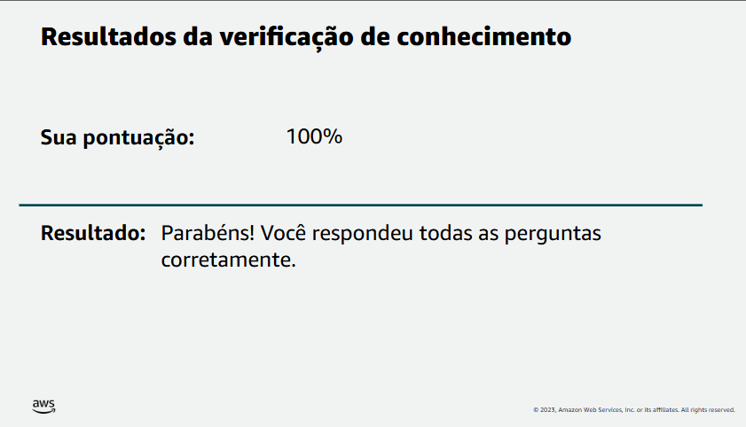

# Lab 01 - Implantação e Gerenciamento de Instância Amazon EC2

## Objetivo

Neste laboratório foi realizada a criação, configuração, monitoramento e gerenciamento de uma instância Amazon EC2 utilizando os recursos disponibilizados pelo ambiente AWS re/Start.

O objetivo foi compreender o ciclo de vida de uma instância EC2, desde sua criação até seu encerramento, além de explorar configurações de segurança, monitoramento, armazenamento e redimensionamento de recursos.

---

## Serviços Utilizados

- Amazon EC2
- Amazon EBS
- Amazon CloudWatch
- Amazon VPC
- Security Groups

---

## Arquitetura do Laboratório

```text
Internet
    │
    ▼
Security Group (HTTP)
    │
    ▼
Amazon EC2
(Amazon Linux 2023)
    │
    ▼
Amazon EBS
```

---

## Etapa 1 - Criação da Instância

Acessado o serviço EC2 através do Console de Gerenciamento da AWS.

### Configurações Utilizadas

| Configuração                 | Valor             |
| ---------------------------- | ----------------- |
| Nome da Instância            | Web Server        |
| Sistema Operacional          | Amazon Linux 2023 |
| Tipo da Instância            | t3.micro          |
| VPC                          | Lab VPC           |
| Chave SSH                    | Não utilizada     |
| Proteção contra Encerramento | Habilitada        |

---

## Etapa 2 - Configuração do Security Group

Foi criado o grupo de segurança:

```text
Web Server Security Group
```

Configuração inicial:

- Nenhuma regra HTTP liberada
- Acesso SSH removido
- Tráfego bloqueado por padrão

Objetivo:

- Aplicar boas práticas de segurança
- Controlar explicitamente os acessos permitidos

---

## Etapa 3 - Configuração do User Data

Foi utilizado um script User Data para automatizar a instalação do servidor web.

### Script Utilizado

```bash
#!/bin/bash
yum -y install httpd
systemctl enable httpd
systemctl start httpd
echo '<html><h1>Hello From Your Web Server!</h1></html>' > /var/www/html/index.html
```

### Resultado

O script executou automaticamente:

1. Instalação do Apache HTTP Server
2. Habilitação do serviço na inicialização
3. Inicialização do serviço
4. Criação da página web padrão

---

## Etapa 4 - Inicialização da Instância

Após o provisionamento foram analisadas as informações da instância:

- Instance ID
- Tipo da Instância
- Endereço IPv4 Público
- DNS Público
- VPC
- Subnet
- Status da Instância

### Resultado

✅ Instância criada com sucesso

✅ Estado da instância: Running

✅ Verificações de status aprovadas

---

## Evidência

### Instância em Execução


---

## Etapa 5 - Monitoramento da Instância

Foram utilizadas as funcionalidades de monitoramento disponibilizadas pelo Amazon CloudWatch.

### Métricas Observadas

- CPUUtilization
- Network In
- Network Out
- Status Checks

Além disso, foi utilizada a opção:

```text
Monitor and Troubleshoot
→ Get Instance Screenshot
```

Para visualizar a saída da instância durante o processo de inicialização.

---

## Etapa 6 - Liberação de Acesso HTTP

Ao acessar o IP público pela primeira vez, a página não foi exibida.

### Motivo

O Security Group não possuía regra liberando tráfego HTTP na porta 80.

### Correção

Foi adicionada a seguinte regra:

| Configuração | Valor         |
| ------------ | ------------- |
| Tipo         | HTTP          |
| Porta        | 80            |
| Origem       | Anywhere IPv4 |

Após salvar a regra, o acesso ao servidor web foi liberado.

### Resultado Esperado

```html
Hello From Your Web Server!
```

---

## Etapa 7 - Redimensionamento da Instância

A instância foi interrompida e teve seu tipo alterado.

### Antes

```text
t3.micro
```

### Depois

```text
t3.small
```

### Benefício

- Mais memória disponível
- Maior capacidade de processamento
- Melhor desempenho para workloads maiores

---

## Evidência

### Instância Redimensionada


---

## Etapa 8 - Redimensionamento do Volume EBS

O volume associado à instância foi expandido.

### Antes

```text
8 GiB
```

### Depois

```text
10 GiB
```

### Objetivo

Aumentar a capacidade de armazenamento disponível para o sistema operacional e aplicações.

---

## Etapa 9 - Teste de Proteção Contra Encerramento

Foi realizada uma tentativa de encerrar a instância.

### Resultado

❌ Operação bloqueada

A instância possuía:

```text
Termination Protection = Enabled
```

Após desabilitar a proteção:

✅ Instância encerrada com sucesso

---

## Conhecimentos Aplicados

Durante este laboratório foram praticados os seguintes conceitos:

- Amazon EC2
- Amazon Machine Images (AMI)
- Security Groups
- Amazon VPC
- Amazon EBS
- User Data Scripts
- Amazon CloudWatch
- Monitoramento de Instâncias
- Escalabilidade Vertical
- Proteção Contra Encerramento
- Gerenciamento do Ciclo de Vida de Instâncias

---

## Resultado da Avaliação

### Pontuação Obtida

✅ **100%**

Todas as questões da verificação de conhecimento foram respondidas corretamente.

### Evidência



---

## Lições Aprendidas

- Como criar uma instância Amazon EC2.
- Como selecionar uma AMI adequada.
- Como utilizar User Data para automação.
- Como configurar Security Groups.
- Como liberar acesso HTTP.
- Como monitorar recursos utilizando CloudWatch.
- Como alterar o tipo de uma instância.
- Como expandir volumes EBS.
- Como utilizar proteção contra encerramento.
- Como encerrar recursos de forma segura.

---

## Conclusão

Este laboratório proporcionou uma experiência prática com o Amazon EC2, permitindo compreender as etapas de criação, configuração, monitoramento, segurança e redimensionamento de uma instância na AWS.

A atividade reforçou conceitos fundamentais de Computação em Nuvem e demonstrou como os serviços da AWS podem ser utilizados para disponibilizar aplicações de forma rápida, escalável e segura.
